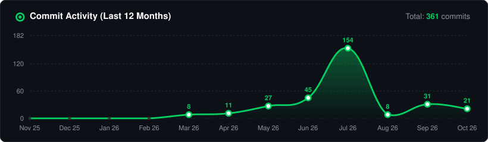

## 📊 GitHub Activity

---

## 📁 My Projects
Here is the list of projects I am working on:

### 🌐 Public Projects (Top 3 Recent)
- 🌐 [cognitive-file-organizer-skill](https://github.com/Filenametxt/cognitive-file-organizer-skill) — *AI Agent Skills (/fsortcheck & /fsortdump) for cognitive file & cloud storage organization using Miller's Law (7 +- 2), self-documenting READMEs, and MCP (Nextcloud, WebDAV, Local FS). Tested on Unsloth Desktop.* (0 commits)
- 🌐 [Filenametxt](https://github.com/Filenametxt/Filenametxt) — *Profile description repo* (11 commits)
- 🌐 [GymFly](https://github.com/Filenametxt/GymFly) — *Gestionale palestra: architettura a 4 livelli, PHP, Smarty e persistenza via Doctrine.* (188 commits)

### 🔒 Private Projects (Top 3 Recent)
- 🔒 **immich-gemma-bridge** (0 commits)
- 🔒 **opencode-local-agents** (21 commits)
- 🔒 **BT_FabioAngelucci** (43 commits)

---

*This README updates automatically via GitHub Actions.*
